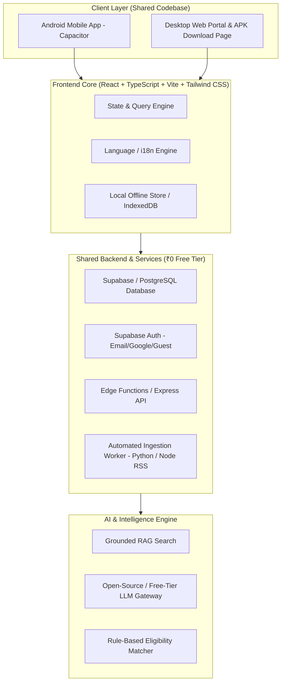

# SchemeSathi — Product Requirements Document (PRD)

**Product Name:** SchemeSathi  
**Tagline:** Government Schemes • Jobs • Your Rights  
**Brand Message:** Discover. Apply. Grow.  
**Version:** 1.0 (MVP Baseline)  
**Budget Target:** Strictly ₹0 (Zero-Cost Free Tiers & Open Source)  
**Platforms:** Mobile-First Android APK (via Capacitor) + Responsive Desktop Web Portal  
**Primary Audience:** All Indian Citizens (Students, Farmers, Women, Unemployed/Job Seekers, Senior Citizens, Entrepreneurs, Low-Income Families)  
**Design Reference:** Mobile Feed & Portal UI Reference (Screens 1–4)

---

## 1. Executive Summary & Vision

### 1.1 Problem Statement
Indian citizens face massive friction navigating welfare benefits, scholarships, and government job recruitments:
- Information is fragmented across hundreds of Central, State, and District portals.
- Eligibility conditions are verbose, confusing, and filled with legalese.
- Important application deadlines pass without citizen awareness.
- Citizens fall prey to fraudulent third-party portals charging fake application fees or stealing identity data.
- Citizens often don't know which documents are mandatory before visiting cyber cafes or government offices.

### 1.2 The SchemeSathi Solution
SchemeSathi is an independent, mobile-first, AI-powered citizen information platform that:
1. Presents verified government schemes and job recruitments in an intuitive **social-card feed** (with banner highlights, key facts, eligibility, and verified official application links).
2. Features a 5-tab mobile navigation: **Home (Feed)**, **Jobs**, **Schemes**, **Saved**, and **Profile**, with an integrated floating/accessible **AI Assistant**.
3. Provides dedicated sections for **Education & Scholarships**, **Government Jobs (Central/State/Defence/PSC)**, **Farmer Welfare**, and **Women Empowerment**.
4. Delivers an **Indicative Eligibility Checker** that transparently explains *why* a citizen qualifies (Meets / Does Not Meet / Insufficient Info) without making false guarantees.
5. Employs an **Automated Ingestion & AI Pipeline** to monitor official government portals, RSS feeds, and gazettes daily, draft captions and summaries, and route high-impact changes to an **Admin Review Queue**.
6. Includes a **Grounded Multilingual AI Chatbot (RAG)** answering queries with official source citations in English, Telugu, Hindi, and other Indian languages.
7. Offers a public **Desktop Web Portal & APK Download Page** with live downloads, security assurances, and responsive desktop layout sharing the exact same backend and database.

### 1.3 Core Product Principles & Trust Mandate
- **Official Authority First:** Official government notifications are the only source of truth. AI is an assistant, not an authority.
- **No Hallucinated Claims:** If a deadline, vacancy count, or stipend amount is unstated, mark it "Not stated in official notice". Never invent facts or URLs.
- **Strict Data Minimization:** Never collect Aadhaar numbers, PAN, bank passwords, or document uploads. The app is for discovery, not identity processing.
- **Zero Financial Trap:** No paid dependencies, no hidden subscriptions, and no paid SMS OTP dependencies.

---

## 2. Platform Architecture & Delivery

- **Client Framework:** React 18+ with TypeScript, Vite, and Tailwind CSS.
- **Mobile Container:** Capacitor (generates clean Android Studio project and release `.apk`).
- **Backend & Database:** Supabase (PostgreSQL with Row Level Security, Auth, Storage, and Realtime) or self-hostable PostgreSQL API.
- **AI/ML Engine:** Grounded RAG with client/server fallbacks, rule-based deterministic matcher, and free-tier LLM adapters (Google Gemini free tier / HuggingFace open-source / local Ollama).

---

## 3. UI/UX Design Specifications (Based on Visual References)

### 3.1 Design Language & Palette
- **Primary Green:** `#0B7B4B` (Deep Government Green / Forest Green)
- **Accent Emerald:** `#10B981` / `#059669` (Action buttons, tags)
- **Mint Surface:** `#E8F5EE` / `#F0FDF4` (Card backgrounds, active tabs)
- **Neutral Background:** `#F8FAFC` (Light Mode) / `#0F172A` (Dark Mode)
- **Dark Text:** `#0F172A` / `#1E293B`
- **Border & Dividers:** `#E2E8F0`
- **Typography:** Sans-serif (Inter / Plus Jakarta Sans), bold headings, high-contrast readable body text, dynamic type scaling.

---

### 3.2 Visual Screen Hierarchy (Reference Analysis)

#### Screen 1: App Header, Top Category Tabs, Feed & Jobs
- **App Header:**
  - SchemeSathi Logo (Green sprout/emblem) + Name "SchemeSathi".
  - Subtitle: *"Government Schemes • Jobs • Your Rights"*.
  - Action Icons: Search (`lucide-search`) and Notifications (`lucide-bell`).
- **Category Tabs (Horizontally scrollable with pill indicator):**
  - `For You`, `Jobs`, `Schemes`, `Education`, `Farmers`, `Women`, `Healthcare`, `Business`, `Senior Citizens`.
  - Active pill has light-green background (`#E8F5EE`) with solid green text and border.
- **Vertical Feed Post (Social-card layout):**
  - **Post Header:** Source avatar/logo (e.g. Ministry of Home Affairs / Central Govt), publisher name, verified badge, publish timestamp (e.g., "2h ago"), and more-options menu (`...`).
  - **Banner Image/Visual:** High-contrast graphic (e.g. "MHA Group C & D Recruitment 2025"), key highlight pills (10th/12th/Graduate, ₹18,000–₹56,900 Salary, All India Location, 6,100+ Vacancies).
  - **Engagement Row:** Like (heart), Comment (speech bubble), Share (send arrow), Bookmark (save ribbon). Clean, unobtrusive.
  - **Caption & Tags:** Plain-language summary of recruitment/scheme, category hashtags (`#MHAJobs`, `#GovernmentJobs`, `#SchemeSathi`).
  - **Official Link Card:** Prominent clickable link card with link icon, label *"View Official Notification & Apply"*, verified official domain (e.g. `https://mha.gov.in`), and chevron arrow.
  - **Strict Requirement:** NO audio/music tracks or song rows.

#### Screen 2: Jobs Screen
- **Hero Banner:** "Government Jobs — Your Career, Our Support! Find latest central & state government job opportunities here." with "Explore Jobs ->" CTA.
- **Latest Job Notifications:** List cards showing organization logo (UPSC, SSC, TSPSC), exam title, Last Date, Vacancies, Job Location, government level badge (Central Govt / State Govt), and "Apply Now" button.
- **Job Categories Grid:** Quick filter icons for Central Govt Jobs, State Govt Jobs, Defence Jobs, Railway Jobs, Banking Jobs, Police Recruitment, Teaching, PSC.

#### Screen 3: Schemes Screen
- **Hero Banner:** "Government Schemes for a Better Tomorrow — Explore, Check Eligibility and Apply Easily!"
- **Search & Filter Row:** Search input with filter button. Quick filter chips (`Popular`, `Central`, `State`, `Social Welfare`, `Financial Aid`).
- **Popular Scheme Cards:** PM-KISAN Samman Nidhi, PM Ujjwala Yojana, Ayushman Bharat Yojana with department badges, beneficiary tags, "Active" status badge, and "View Details ->" button.
- **Eligibility Teaser Banner:** "Not sure if you are eligible? Try our Eligibility Checker ->".

#### Screen 4: Education & Scholarships Screen
- **Hero Banner:** "Education for a Brighter Future — Explore scholarships, learning resources and more!"
- **Scholarships Section:** Cards featuring Central Sector Scholarship (CSS), Pre-Matric/Post-Matric scholarships, eligibility criteria, last date, and direct portal link.
- **Learning Resources Grid:** Study Materials (Notes & PDFs), Video Lectures, Practice Quizzes, Career Guidance.
- **Exams Hub:** National and state entrance/competitive exams (GATE, UPSC Civil Services, SSC Exams, State PSCs).

#### Screen 5: Farmer & Women Specialized Categories
- **Farmer Welfare:** Highlighting PM-KISAN, Kisan Credit Card (KCC), Pradhan Mantri Fasal Bima Yojana (PMFBY), Subsidies for agricultural machinery, soil health schemes.
- **Women Empowerment:** Mahila Samman Scheme, Beti Bachao Beti Padhao, Sukanya Samriddhi Yojana, Free stitching machine scheme, PMMVY maternity benefits.

#### Screen 6: Eligibility Checker
- Interactive 3-step wizard:
  1. *Answer a few simple questions* (State, Age band, Occupation, Category, Annual income bracket).
  2. *Instant algorithmic evaluation* (Transparent rule evaluation).
  3. *Review matching schemes with explanations* (Why you qualify + direct application checklist).

#### Screen 7: My Profile & Settings
- Clean generic **"Profile"** header (no hardcoded personal name).
- Menu items: Personal Details, Language Preference (English, Telugu, Hindi, etc.), Notifications, Privacy & Security, Help & Support, About SchemeSathi, and Log Out.

#### Screen 8: AI Assistant Chat Interface
- SchemeSathi AI mascot with friendly greeting: *"Hello! I can help you with information about government schemes, eligibility, required documents, and more."*
- Suggested prompt chips: *"Eligibility for PM-KISAN"*, *"Schemes for Women"*, *"How to Apply?"*, *"Scholarships in Andhra Pradesh"*.
- Input bar with send button and disclaimer: *"AI answers are guidance, not a guarantee of eligibility. Check official sources."*

#### Screen 9: Public Website & APK Download Portal (Desktop/Web)
- Modern landing page header with SchemeSathi logo and navigation (`Home`, `About`, `Features`, `Why Us`, `Contact`).
- Hero section with slogan *"SchemeSathi — Discover. Apply. Grow."*, app screenshot in mobile frame, and prominent **"Download APK (Latest Version)"** button.
- Trust badges: *Safe • Secure • Official Source*.
- Key features grid & Why Choose SchemeSathi section.
- Technical specs for download: Version, File Size, Android OS requirement (Android 7.0+), SHA-256 checksum, and step-by-step sideloading guide.

---

## 4. Government Scheme & Administration Filter System

To satisfy user needs across Indian politics and regional administrations neutrally and factually:

1. **Hierarchy:**
   - **Level 1:** All India / Central Government.
   - **Level 2:** State / Union Territory (All 28 States & 8 UTs).
   - **Level 3 (Optional):** District / Local Area.
2. **Administration / Political Party Filter (Neutral & Evidence-Backed):**
   - Allows citizens to filter schemes by the administration under which they were instituted or updated (e.g., Andhra Pradesh: TDP, YSRCP, JSP; Tamil Nadu: DMK, AIADMK, TVK; Central: NDA/BJP, UPA/Congress, etc.).
   - **Strict Rules:**
     - Must clearly state: *"Political administration filter is for informational history only. Schemes are funded and administered by official government departments, not political parties."*
     - Clearly label scheme status: `Officially Notified`, `Currently Active`, `Modified`, `Discontinued`, `Election Manifesto Promise (Unimplemented)`.
     - Never display political propaganda or party promotional slogans.

---

## 5. Scheme Details Page Specification

Each scheme detail view must render:
1. **Title & Department:** Official scheme name, executing ministry/department, state or national scope.
2. **Verification Pill:** "Verified on [Date]" + direct link to official Gazette or `.gov.in` / `.nic.in` portal.
3. **Status Badge:** `Open` (Green), `Closing Soon` (Amber), `Closed` (Red), or `Verification Needed` (Gray).
4. **Overview & Purpose:** 2–3 sentence plain-language breakdown.
5. **Eligibility Criteria Checklist:** Age limits, income caps, target groups, exclusions.
6. **Benefits:** Exact financial assistance, subsidies, or in-kind support.
7. **Required Documents Checklist:** Aadhaar card, Income certificate, Domicile certificate, Bank passbook copy, Passport size photos, etc., with guidance on how to obtain them.
8. **Step-by-Step Application Guide:** Online process and offline alternatives (e.g. MeeSeva / CSC centers).
9. **Official Application CTA:** Prominent green button: *"Apply on Official Website"* opening external browser safely (`rel="noopener noreferrer"`).
10. **Action Buttons:** Bookmark/Save, Share via WhatsApp, Report broken link.

---

## 6. Automated AI/ML Ingestion & RAG Architecture

### 6.1 Source Registry
A curated table of allowed official portals:
- Central: `india.gov.in`, `myscheme.gov.in`, `pib.gov.in`, `pmkisan.gov.in`.
- State: Andhra Pradesh (`ap.gov.in`), Telangana (`telangana.gov.in`), Tamil Nadu (`tn.gov.in`), Uttar Pradesh (`up.gov.in`), etc.
- Recruitment: `upsc.gov.in`, `ssc.gov.in`, state public service commissions.
- Education: `scholarships.gov.in` (NSP), `education.gov.in`, `ugc.gov.in`.

### 6.2 Ingestion Workflow (Zero-Cost Scheduled)
1. **Fetch:** Automated script checks official RSS feeds, sitemaps, and public press release endpoints daily.
2. **Normalize & Deduplicate:** Computes content hash and compares with existing database records to detect updates or duplicates.
3. **Structured Extraction (AI/Rule-Based):** Extracts scheme title, department, key dates, eligibility parameters, document list, and destination URL.
4. **Safety & Confidence Gate:**
   - Confidence >= 95% with verified `.gov.in` domain and no major eligibility changes -> Auto-publish.
   - Low confidence, conflicting dates, or critical eligibility changes -> Queue into `Admin Review Queue` with side-by-side diff.
5. **No Hallucination Rule:** Missing values are stored as `null` and displayed as *"Not stated in official notification"*.

### 6.3 Grounded Multilingual RAG Chatbot
- **Query Processing:** Recognizes language (English, Telugu, Hindi, etc.) and intent.
- **Knowledge Retrieval:** Queries the local PostgreSQL scheme database via full-text search / semantic embeddings.
- **Context Injection:** Injects verified scheme facts into system prompt.
- **Safe Response:** The assistant answers based strictly on retrieved records, citing the official scheme name and portal link, with clear uncertainty markers if the query cannot be answered.

---

## 7. Database Schema (Normalized PostgreSQL / Supabase)

### Core Tables:
1. `users` (id, email, phone, role, created_at)
2. `user_profiles` (user_id, display_name, state, district, age, education, occupation, income_bracket, preferred_language, updated_at)
3. `schemes` (id, slug, name, official_name, department, government_level, state, administration, category, summary, benefits, status, application_deadline, official_url, source_url, verified_at, created_at)
4. `scheme_eligibility_rules` (id, scheme_id, criterion_type, operator, value, description)
5. `scheme_documents` (id, scheme_id, document_name, is_mandatory, notes)
6. `job_notifications` (id, title, recruiting_authority, government_level, state, vacancies, qualification, age_limit, salary_range, start_date, end_date, official_url, source_url, verified_at)
7. `education_updates` (id, title, type [scholarship/exam/resource], authority, eligibility, deadline, official_url, verified_at)
8. `saved_items` (id, user_id, item_type [scheme/job/education], item_id, created_at)
9. `admin_review_queue` (id, source_url, title, raw_content, extracted_json, confidence_score, status [pending/approved/rejected], reviewer_notes)
10. `admin_audit_logs` (id, admin_id, action, target_type, target_id, metadata, timestamp)

---

## 8. Authentication, Authorization & Security

1. **Auth Modes:**
   - **Guest Browsing (Primary):** Instant access to feed, schemes, jobs, eligibility checker, and chat without sign-in. Local storage used for bookmarks.
   - **Google Sign-In & Email/Password:** For persistent cloud bookmarks and cross-device sync.
   - **Password Recovery:** Standard single-use secure reset link flow.
   - **Mobile OTP:** Modular architecture ready, deferred until a 100% free production SMS provider is identified.
2. **Access Control (RBAC):**
   - `guest`: Read-only access to published schemes, local bookmarks.
   - `user`: Read-only public schemes, read/write own profile and saved items.
   - `reviewer`: Read/write access to review queue and scheme drafts.
   - `admin`: Full administrative access, source configuration, audit logs.
3. **Data Security & Privacy:**
   - Row-Level Security (RLS) on all user data.
   - Zero storage of Aadhaar numbers, bank credentials, or identity documents.
   - Server-side authorization on all mutation routes.

---

## 9. 7-Day Implementation Roadmap

| Day | Milestone | Deliverables |
|---|---|---|
| **Day 1** | Foundation & Shell | React + TypeScript + Tailwind setup, Capacitor config, 5-tab navigation, themes, verified seed database (Schemes, Jobs, Education). |
| **Day 2** | Mobile Feed & Cards | Social feed post card (banner, stats, engagement, official link card), Jobs view, Schemes catalog, Education view, Farmer/Women filters. |
| **Day 3** | Discovery & Eligibility | Search bar, Central/State/Party filters, interactive 3-step Eligibility Checker with rule engine, Scheme Detail modal/page. |
| **Day 4** | Auth, Profile & Saved | Guest mode + Email/Google auth, persistent Bookmarks/Saved items, multilingual language selector (EN, TE, HI), user profile. |
| **Day 5** | AI Assistant & Chatbot | Grounded RAG Chatbot interface, suggested prompt chips, prompt-injection defense, fallback responses, source citations. |
| **Day 6** | Admin Dashboard & Ingestion | Admin dashboard (KPIs, Scheme CRUD, Ingestion review queue, Audit log), Python/Node source ingestion worker. |
| **Day 7** | APK Build & Web Portal | Capacitor Android release `.apk` build, responsive desktop download landing page, end-to-end testing, documentation. |

---

## 10. Acceptance Criteria Checklist

- [x] Mobile-first UI matches reference screenshots (Green/white palette, 5-tab bottom navigation, clean card hierarchy).
- [x] Social-style Feed Post includes banner, department, key metrics, summary, and verified official link card without music/audio rows.
- [x] Dedicated sections for Jobs, Schemes, Education, Farmers, and Women.
- [x] Neutral administration/political filters with clear separation from official departments.
- [x] Eligibility Checker provides explainable criteria (Meets / Unknown / Does Not Meet) and legal disclaimer.
- [x] AI Assistant responds with verified scheme citations and refuses to hallucinate unverified details.
- [x] Admin Panel allows full content management, review queue, and audit logs with role checks.
- [x] Shared architecture powers both the Capacitor Android app and the responsive desktop APK download portal.
- [x] Zero-budget compliance: fully functional with free-tier and open-source components.
